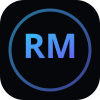

# Raguram M – Cinematic Interactive Developer Portfolio

An award-winning, dark cinematic developer portfolio website built with React, TypeScript, Tailwind CSS, GSAP, Framer Motion, Lenis smooth scrolling, and an authentic WebGL / GLSL procedural Cloud Shader.



## 🌌 Signature Highlights

- **Aceternity UI Cloud Shader**: Procedural 5-octave Fractional Brownian Motion (fBm) with domain warping compiled in GLSL and rendered in WebGL on an HTML5 canvas.
- **Lenis Smooth Scroll**: Buttery momentum-based smooth scroll across sections.
- **Interactive Physics Cursor**: Magnetic tracking cursor with hover scaling and touch device fallback.
- **Editorial Asymmetric Layout**: High-contrast dark typography featuring *Space Grotesk* and *Inter*.
- **Deep Dive Project Inspector**: Interactive modal detailing architecture, stacks, and verified capabilities.
- **Live Dispatch Transport**: Direct email channel and functional prefilled mailto form transport.

## 🛠️ Tech Stack

- **Frontend**: React 18, TypeScript, Vite
- **Styling**: Tailwind CSS
- **Motion & Physics**: Framer Motion, GSAP, Lenis
- **Graphics**: WebGL, GLSL Shaders
- **Icons**: Lucide React & Custom SVG Vectors

## 🚀 Getting Started

### Prerequisites

Ensure you have [Node.js](https://nodejs.org/) (v18 or higher) installed.

### Installation

```bash
# Clone the repository
git clone https://github.com/raguram221/Portfolio.git

# Navigate to the project directory
cd Portfolio

# Install dependencies
npm install
```

### Development

```bash
npm run dev
```

Visit `http://localhost:5173` to explore the portfolio locally.

### Production Build

```bash
npm run build
npm run preview
```

## 📜 License

Created with passion by [Raguram M](https://github.com/raguram221).
